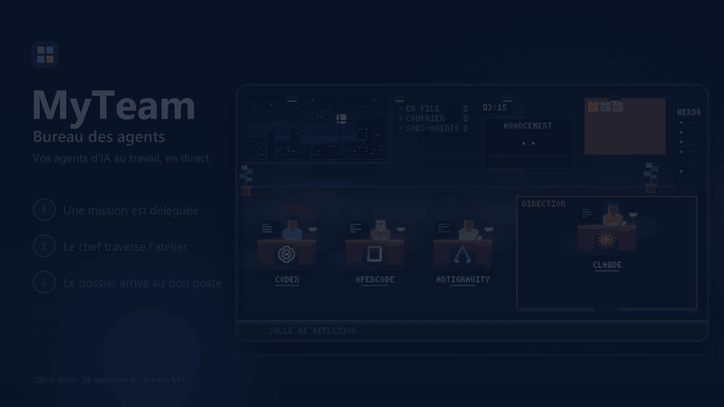

# MyTeam · Agent desk

**🌐 Official website: [https://blackangel242.github.io/MyTeam/](https://blackangel242.github.io/MyTeam/)** · [Français](README.md)

Watch your [Herdr](https://github.com/herdrdev/herdr) AI agents work in a pixel art office, send them instructions and read their replies. Everything stays on your machine.

[](LICENSE)
[](package.json)
[](https://github.com/BlackAngel242/MyTeam/actions/workflows/ci.yml)
[](package.json)

[](https://blackangel242.github.io/MyTeam/)

- **Who does what, live**: who works, waits or finishes, tested with up to 10 agents.
- **You stay in control**: queue, crisis room, capped Autonomy mode you can stop.
- **Local and plain**: `127.0.0.1` only, zero npm dependencies, nothing invented on screen.

## Quick start

```bash
git clone https://github.com/BlackAngel242/MyTeam.git && cd MyTeam
node server.mjs   # or double-click "Installer MyTeam.bat" on Windows
```

Open `http://127.0.0.1:4317`. Requirements: [Node.js](https://nodejs.org) 22 or later and [Herdr](https://herdr.dev).

## Learn more

[Website](https://blackangel242.github.io/MyTeam/) · [User guide](docs/aide.en.md) · [Installation](docs/INSTALLATION.en.md) · [Team kit](docs/kit.en.md) · [Changelog](CHANGELOG.en.md) · [Contributing](CONTRIBUTING.en.md) · [Notices and trademarks](NOTICE.en.md)

## Built with the help of AI

This project was brought to life with the assistance of artificial intelligence: Claude (Anthropic), Codex (OpenAI), Antigravity (Google), and OpenCode (MiMo) assisted in designing, writing, and testing it. **The author and project contributor is DrSmoke** ([BlackAngel242](https://github.com/BlackAngel242)): ideas, architectural decisions, and releases remain his own, and no AI signs any contribution. Details in [`docs/credits-ia.md`](docs/credits-ia.md).

## License

Distributed under the MIT License. See [LICENSE](LICENSE) for details.
