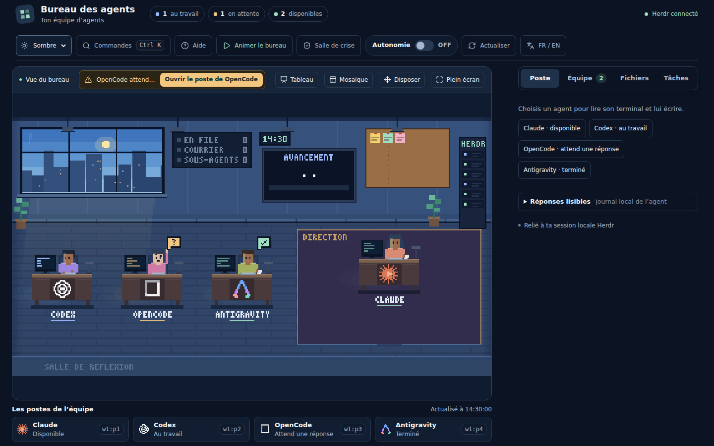

# MyTeam · Le Bureau des agents

> 🌐 **Langue / Language** : **Français** | [English](README.en.md)  
> 📚 **Index de la documentation** : [docs/index.md](docs/index.md) ([English index](docs/index.en.md))

Un tableau de bord immersif et vivant en pixel art pour surveiller, lire et piloter vos équipes d'agents d'intelligence artificielle autonomes exécutés dans Herdr.

[](LICENSE)
[](package.json)
[](https://github.com/BlackAngel242/MyTeam/actions/workflows/ci.yml)
[](package.json)


> *Vue d'ensemble de la scène en journée : chef au bureau Direction, tableau mural d'indicateurs, collaborateurs à leurs postes et salle de réflexion vitrée.*

---

## Sommaire

- [Pour qui et pourquoi ?](#pour-qui-et-pourquoi-)
- [Installation rapide](#installation-rapide)
  - [1. Préparation automatique](#1-préparation-automatique)
  - [2. Démarrage du bureau](#2-démarrage-du-bureau)
- [Fonctionnalités](#fonctionnalités)
  - [Scène animée et bureau Direction](#scène-animée-et-bureau-direction)
  - [Onglet Poste et terminal en direct](#onglet-poste-et-terminal-en-direct)
  - [Onglet Équipe, direction et file d'attente](#onglet-équipe-direction-et-file-dattente)
  - [Onglets Fichiers et Tâches](#onglets-fichiers-et-tâches)
  - [Palette de commandes, aide et signaux](#palette-de-commandes-aide-et-signaux)
  - [Mode plein écran](#mode-plein-écran)
- [Principes et vérité des faits](#principes-et-vérité-des-faits)
- [Contribuer](#contribuer)
- [Entretien sans IA](#entretien-sans-ia)
- [Licence et marques](#licence-et-marques)

---

## Pour qui et pourquoi ?

MyTeam (le Bureau des agents) s'adresse aux développeurs, chercheurs et orchestrateurs qui font collaborer plusieurs agents d'IA en parallèle (Claude Code, Codex, Antigravity, OpenCode) sous le gestionnaire de sessions [Herdr](https://github.com/atoll92/herdr). Il transforme une mosaïque aride de terminaux en un atelier graphique vivant où chaque geste compte.

- **Organisation d'équipe claire** : Le bureau Direction accueille le chef d'équipe, entouré de ses collaborateurs sur leurs postes dédiés.
- **Délégations incarnées** : Quand le chef délègue une mission (`herdr agent prompt`), il effectue sa tournée physique dans la pièce pour déposer le dossier doré sur le bureau du collaborateur.
- **File d'attente avec priorités** : Différez vos consignes en toute sérénité pour les agents occupés ou en pause de limite, avec option prioritaire, bouton « Passer en tête » et relance automatique.
- **Salle de réflexion vitrée** : Les sous-agents quittent leur poste pour plancher ensemble dans un espace dédié avant de rapporter leurs résultats.
- **Suivi factuel des tâches** : Centralisation des cases cochées dans les fichiers du projet (`TODO.md`) et des plans publiés par les agents eux-mêmes, sans aucun pourcentage inventé.
- **100% local et zéro dépendance** : Serveur local autonome sur `127.0.0.1`, aucune dépendance npm, aucun appel réseau sortant et aucune clé d'API stockée.

---

## Installation rapide

MyTeam fonctionne sur Windows, macOS et Linux. Il nécessite uniquement [Node.js](https://nodejs.org) (version 22 ou supérieure) et [Herdr](https://github.com/atoll92/herdr). Aucun téléchargement de paquet externe (`npm install`) n'est requis.

### 1. Préparation automatique

Deux méthodes d'installation sont disponibles selon vos préférences :

#### Méthode 1 : Par la release (recommandée, sans Git)

1. Téléchargez le fichier ZIP de la dernière version sur la page [Releases du dépôt GitHub](https://github.com/BlackAngel242/MyTeam/releases).
2. Décompressez l'archive dans le dossier de votre choix.
3. Lancez l'installation :
   - **Sous Windows** : double-cliquez sur `Installer MyTeam.bat`. Si Node.js (version 22 ou supérieure) est présent, l'installeur animé démarre directement (bannière en dégradé pixel art, liste de tâches actualisée en direct, progression visuelle, étape facultative Clink pour le confort de cmd.exe, et confirmations interactives o/n pour chaque outil ou intégration). Si Node.js est absent ou trop ancien, le script bascule en mode texte sécurisé pour vous proposer son installation via winget, puis vous invite à relancer le fichier .bat pour profiter de l'expérience animée.
   - **Sous macOS ou Linux** : ouvrez un terminal dans le dossier et lancez `bash scripts/installer.sh` (ou `node scripts/installateur-anime.mjs` si Node.js est déjà présent).

> [!NOTE]
> **Avertissement Windows SmartScreen** : Comme tout script `.bat` téléchargé depuis Internet sans signature numérique commerciale payante, Windows SmartScreen peut afficher une fenêtre préventive (« Windows a protégé votre ordinateur »). Vous pouvez poursuivre en toute sécurité en cliquant sur **Informations complémentaires** puis sur **Exécuter quand même**, ou en amont par un clic droit sur le fichier `.bat` (ou l'archive `.zip` avant extraction) > **Propriétés** > cocher la case **Débloquer** en bas > **OK**.

> [!TIP]
> **Mode démonstration** : Vous pouvez prévisualiser l'animation de l'installeur sans rien installer ni modifier sur votre machine en exécutant :
> ```bash
> node scripts/installateur-anime.mjs --demo
> ```

#### Méthode 2 : Par clonage du dépôt Git (pour les développeurs)

Clonez le dépôt puis lancez le script correspondant à votre système :

- **Sous Windows (PowerShell) :**
  ```powershell
  git clone https://github.com/BlackAngel242/MyTeam.git
  cd MyTeam
  powershell -ExecutionPolicy Bypass -File scripts\installer.ps1
  ```
  *(ou double-cliquez directement sur `Installer MyTeam.bat`)*

- **Sous macOS ou Linux (bash) :**
  ```bash
  git clone https://github.com/BlackAngel242/MyTeam.git
  cd MyTeam
  bash scripts/installer.sh
  ```

> [!TIP]
> **Ce que fait et ne fait pas l'installation** : Les scripts vérifient Node.js (>= 22) et Herdr, créent une grille Herdr 2×2 (`Chef`, `Agent 2`, `Agent 3`, `Agent 4`), détectent les 24 outils compatibles, proposent Clink sous Windows (confort de cmd.exe via winget), les intégrations officielles `herdr integration install`, la compétence du chef (`herdr --skill` ou `CHEF.md`), la consigne d'orientation, 3 raccourcis de bureau (dont « Herdr et bureau » combiné) et l'initialisation du kit d'équipe (`node scripts/init-kit.mjs`). Ils n'installent aucune dépendance npm, ne demandent ni ne stockent aucune clé API, et ne valident aucune installation silencieuse : le commutateur `-Oui` / `--oui` n'auto-approuve jamais les installations ou lancements (un accord individuel o/n reste obligatoire). Paramètres utiles : `-DryRun` / `--dry-run` (simulation), `-Lang fr|en` / `--lang fr|en`, `-Port` / `--port`, `-HerdrChemin` / `--herdr-chemin`, `-SansRaccourci` / `--sans-raccourci`. Consultez [docs/INSTALLATION.md](docs/INSTALLATION.md) ([English](docs/INSTALLATION.en.md)) pour le guide complet.

### 2. Démarrage du bureau

Une fois les prérequis validés, démarrez le serveur local :

```powershell
node server.mjs
```

*(Sous Windows, vous pouvez également double-cliquer directement sur le raccourci `Ouvrir le bureau.cmd` ou le raccourci combiné « Herdr et bureau »)*

Ouvrez ensuite l'application dans votre navigateur :
```text
http://127.0.0.1:4317
```

### 3. Parcours après installation en 6 étapes

1. **Ouvrir le raccourci** : Double-cliquez sur le raccourci « Herdr et bureau » (ou ouvrez Herdr puis lancez `node server.mjs`).
2. **Voir les 4 panneaux et le bureau animé** : Constatez l'ouverture des 4 panneaux dans la grille Herdr 2×2 et découvrez l'atelier en direct sur `http://127.0.0.1:4317`.
3. **Le chef lit CHEF.md** : Dans le panneau Chef, le chef d'équipe prend connaissance de `CHEF.md` et `AGENTS.md`, liste ses coéquipiers avec `herdr agent list` et se tient prêt.
4. **Première délégation** : Envoyez une consigne au chef depuis le bureau ; observez sa tournée physique dans la scène jusqu'au poste du collaborateur pour lui remettre le dossier.
5. **Onglet Tâches** : Consultez l'onglet Tâches pour suivre l'avancement factuel des cases de `TODO.md` et des plans d'action publiés, sans pourcentage inventé.
6. **Salle de crise** : Repérez le bouton sous clapet « Salle de crise » (`Ctrl+Maj+C`) permettant de geler instantanément les départs de consignes et de demander une interruption polie par la touche Échap.

---

## Fonctionnalités

### Scène animée et bureau Direction

- **Le chef au bureau Direction, transfert et tournée** : Le bureau Direction accueille le chef d'équipe (par défaut le premier panneau démarré dans Herdr, ou choix explicite de DrSmoke). Une pile de courriers s'y empile dès qu'un agent termine une tâche ; cliquer dessus ouvre directement l'onglet Équipe. À chaque délégation observée dans son journal, le chef réalise sa tournée : il sort de son bureau, traverse la pièce pour poser le dossier titré sur le poste de son collaborateur, puis regagne sa place (une seule tournée à la fois). DrSmoke peut transférer la direction à tout moment, et le bureau propose proactivement une passation si le chef entre en pause de limite.
- **Cycle jour-nuit continu et ambiance du soir** : Le ciel de la baie vitrée évolue en temps réel selon l'horloge de votre machine (lever fixe à 6 h 30 et coucher fixe à 19 h 30, approximation sans saisons). Dès 17 h 30 (et à pleine puissance à 19 h jusqu'au matin), les suspensions au plafond et les lampes de bureau s'allument automatiquement pour éclairer l'atelier. La lampe d'un poste s'éteint si l'agent part en pause de limite.
- **Tableau d'affichage mural** : Un panneau de contrôle synthétise en direct les faits utiles absents du reste de la scène : heure de reprise d'une pause de quota (`RETOUR`), nombre de consignes en attente (`EN FILE`), courriers non lus (`COURRIER`) et sous-agents en activité (`SOUS-AGENTS`). Chaque indicateur s'allume dès que son fait est observé.
- **Tableau de l'équipe (panneau de liège)** : Un panneau de liège mural (dont les punaises colorées suivent les tâches ouvertes) et le bouton « Tableau » ouvrent une fenêtre modale en lecture seule sur les fichiers piliers (`HANDOFF.md`, `TODO.md`, `AGENTS.md`, `LESSONS.md`), avec la source et la date de chaque document, sans aucun risque d'altération et avec chemins sensibles masqués.
- **Chaque poste en un coup d'œil** : Chaque bureau arbore en façade le logo en pixel art 16x16 de son outil (Claude, Codex, Antigravity, OpenCode). Sous chaque bureau, le nom seul de l'agent est affiché, souligné d'un trait fin de la couleur de son état (bleu ciel pour travail, menthe pour disponible, ambre pour attente Herdr, violet pour pause de limite), sans texte redondant. Si la liaison avec Herdr est perdue, la mention `HORS LIGNE` s'affiche sous le bureau.
- **Postures visibles et bulles d'état** : Frappe au clavier quand l'agent est au travail, mug en main quand il est disponible, main levée avec bulle « ? » quand il attend une validation dans Herdr, coche verte quand son travail s'arrête, points de suspension « ... » pour un statut transitoire.
- **Pause de limite et chevalet « RETOUR »** : Si un outil atteint son plafond de requêtes ou de jetons, le fauteuil de l'agent se vide, sa lampe de bureau s'éteint, une veilleuse violette clignote et un chevalet blanc affiche l'heure exacte de reprise annoncée par l'outil.
- **Salle de réflexion vitrée des sous-agents** : Pièce dédiée portant le libellé fixe « SALLE DE REFLEXION », où les sous-agents se réunissent avant de déposer leur dossier complété sur le bureau de leur agent. Le nombre exact de sous-agents actifs est visible au tableau mural, et la salle peut être repliée sur écran compact.
- **Mode « Disposer »** : Le bouton « Disposer » permet de réorganiser librement les bureaux sur le sol à la souris ou aux flèches du clavier, et d'étirer le coin doré du bureau Direction pour l'agrandir. La touche Échap enregistre les positions.
- **Mode Mosaïque (surveillance multi-terminaux)** : Le bouton commutable « Mosaïque » / « Vue scène » (aussi accessible via la palette `Ctrl+K`) remplace le décor par une mosaïque de 2 à 4 terminaux côte à côte. Les collaborateurs au travail s'affichent en tête de liste, avec bascule entre disposition « Grille 2×2 » et « Colonnes », sélecteur de tuiles si plus de 4 agents sont connectés, recherche textuelle réactive surlignée avec compteur de correspondances, envoi rapide de consignes (`Ctrl+Entrée`), bouton « Agrandir » ouvrant le poste individuel, et rafraîchissement économique (toutes les 3 s, suspension quand l'onglet est masqué, une lecture à la fois par tuile, préservation de la sélection de texte).
- **Pause des animations et accessibilité** : Un bouton « Mettre en pause » permet de figer le canvas à tout moment. Si votre système active la réduction des mouvements (`prefers-reduced-motion`), la scène est automatiquement figée par défaut, tout en continuant d'être rafraîchie chaque minute pour suivre l'heure et la luminosité.

### Onglet Poste et terminal en direct

- **Sélection directe** : Dès l'ouverture, une vue d'accueil claire invite à choisir un agent parmi des boutons rapides. Sur mobile, choisir un agent fait défiler la vue automatiquement vers son poste.
- **Barre d'état de l'outil** : Affiche la tâche en cours ou la pensée extraite en direct de l'outil, le modèle utilisé (par exemple GPT-6.1-Sol ou MiMo V2.6 Pro), le mode, l'effort, la jauge visuelle de limite restante avec heure de remise à zéro, et le temps d'exécution écoulé.
- **Sorties du terminal réelles** : Affiche les dernières lignes brutes provenant du terminal Herdr de l'agent sélectionné.
- **Outils de confort** : Champ de recherche avec surlignage instantané des occurrences et compteur, bouton « Figer » pour suspendre le défilement automatique, bouton « Copier » pour récupérer le texte, et bouton « Agrandir » pour lire le terminal en pleine hauteur (avec hauteur dédiée confortable sur smartphone).
- **Pause automatique sur sélection** : Dès qu'une sélection de texte est active à la souris dans les sorties, le rafraîchissement se met en pause pour ne jamais faire sauter votre sélection.
- **Volet « Réponses lisibles »** : Sous le terminal, un volet dépliable (composant `public/response-card.js` branché sur `GET /api/reponses`) restitue les réponses structurées de l'agent lues dans son journal local (Claude, Codex, OpenCode). Il propose un rendu Markdown sûr sans `innerHTML`, la copie par bloc de code, la copie fidèle du texte source Markdown, l'export en `.md` (marqué « partiel » si la réponse est en cours) et un repli accessible pour le presse-papiers.
- **Formulaire de consigne, mise en file et priorité** : Si l'agent est disponible, le formulaire permet un envoi immédiat (Ctrl+Entrée ou Cmd+Entrée). S'il est occupé ou en pause de quota, le bouton affiche « Mettre en file » pour différer l'envoi en toute sécurité. Une case à cocher « Prioritaire » permet de marquer une consigne urgente (`priority: "haute"`) pour qu'elle passe devant les consignes normales du même agent.
- **Conservation des brouillons** : Changer d'agent pendant la rédaction ou l'envoi d'une consigne ne détruit aucun texte ; chaque brouillon est mémorisé indépendamment.

### Onglet Équipe, direction et file d'attente

- **Direction de l'équipe et passation** : Affiche le chef effectif et permet à DrSmoke de désigner n'importe quel autre agent connecté comme chef ou de rétablir la règle par défaut (premier panneau). Le choix est persisté hors Git dans `.bureau/direction.json`. Si le chef entre en pause de limite, un bandeau propose proactivement de passer la direction à un suppléant disponible. DrSmoke valide le changement, et le message de passation préparé est relu et validé avant d'être expédié (par envoi direct ou en tête de file). Les délégations de missions sont ensuite suivies dans le journal du chef effectif.
- **Courrier du chef** : Enregistre les fins de travail observées avec compteur dans le titre de section ; la liste se remet à zéro dès que vous consultez l'onglet Équipe. Cliquer sur un courrier ouvre directement le terminal de l'agent pour vérifier son travail.
- **File d'attente collective et gestion des priorités** : Liste toutes les consignes différées avec leur cible, statut et niveau de priorité (« haute » ou « normale »), ordonnées selon l'ordre réel d'envoi. Un bouton « Passer en tête » permet de promouvoir une consigne normale en attente. Les consignes hautes partent en premier dès que l'agent est libre. Un garde-fou automatique promeut toute consigne normale en attente depuis plus de 30 minutes au rang des hautes pour prévenir la famine. Chaque consigne peut être retirée d'un clic, sans jamais forcer d'envoi vers un agent occupé.
- **Fichiers joints et fichiers confiés** : Vous pouvez joindre des fichiers locaux à une consigne mise en file d'attente (plafond de 2 fichiers de 20 Mo). Les fichiers sont copiés sans écrasement dans le dossier de travail de l'agent avant l'expédition, et les faits observés lors du traitement sont consultables dans la section « Fichiers confiés » de l'onglet Équipe.
- **Fil de discussion (salle de contrôle)** : Réunit les extraits des dernières réponses de toute l'équipe (composant `public/discussion.js` branché sur `GET /api/discussion`), classées de la plus récente à la plus ancienne. Les agents non lus sont explicitement signalés en bas de liste avec leur raison (« non exposé par cet outil » ou « non rattaché avec certitude »).
- **Disjoncteur général « Salle de crise »** : Un bouton de protection sous clapet « Salle de crise » (raccourci d'urgence `Ctrl+Maj+C` ou palette de commandes) déclenche un gel instantané de tous les départs de consignes (code HTTP 423) et suspend la file d'attente sans rien altérer. La scène s'entoure d'un halo ambré de sécurité et une modale de diagnostic détaille l'état et les dernières sorties de chaque agent. DrSmoke peut alors demander une interruption polie (`POST /api/crise/arret`) qui transmet la touche Échap canonique (`esc` dans Herdr) à l'agent ciblé après confirmation, sans jamais recourir à un arrêt forcé (`kill`). L'état est persisté atomiquement dans `.bureau/crise.json` (crise active par sécurité si le fichier est corrompu).
- **Message à plusieurs agents (envoi groupé armé)** : Cochez les agents disponibles ou cliquez sur « Cocher tous les disponibles ». Le premier clic sur « Envoyer » arme l'envoi en affichant la liste des destinataires, et le second confirme l'expédition individuelle via Herdr.
- **Journal des envois** : Consigne l'historique complet des transmissions de la session avec l'horodatage, les destinataires, le texte et le statut retourné par Herdr.

### Onglets Fichiers et Tâches

- **Onglet Fichiers (Explorateur sécurisé)** : Consultation rapide des fichiers récemment créés ou modifiés (dernières 48 h) dans le dossier de travail de l'agent sélectionné, ou navigation dossier par dossier avec fil d'Ariane. Les emplacements sont strictement limités au dossier de travail de chaque agent, au Bureau, aux Documents et aux Téléchargements. Bouton « Afficher » pour révéler le fichier dans l'Explorateur Windows. Glisser-déposer standard pour copier un fichier, ou Maj + glisser-déposer pour le déplacer (avec double validation). Aucune suppression et aucun écrasement de fichier ne sont autorisés (renommage automatique avec indice numérique).
- **Onglet Tâches (Suivi factuel avec pourcentage)** : Tableau de bord observant les cases cochées dans les fichiers Markdown du projet (`TODO.md`) et les plans d'action publiés par les agents dans leurs journaux d'activité. La barre de progression et le pourcentage affiché sont strictement calculés sur le ratio de tâches cochées. Si aucun plan n'est publié, la mention « Aucun plan publié par un agent pour le moment » est fidèlement affichée.

### Palette de commandes, aide et signaux

- **Palette de commandes (Ctrl+K)** : Ouvre une boîte modale au clavier pour chercher un agent, ouvrir son poste, rédiger une consigne, ouvrir le tableau de l'équipe, changer d'onglet ou lancer une action sans toucher à la souris.
- **Aide contextuelle escamotable (touche ?)** : Volet latéral accessible par le bouton « Aide » ou la touche « ? », présentant la visite guidée en 5 étapes, la légende visuelle de la scène, la table complète des raccourcis clavier et le réglage des signaux.
- **Signaux : Sons 8 bits et notifications Windows** : Notifications système Windows quand la page est en arrière-plan (relève toutes les 15 secondes quand l'onglet est masqué), et signaux sonores discrets synthétisés en Web Audio (`public/sounds.js`) pour les blocages, fins de travail, pauses de limite et délégations. Les préférences sont mémorisées dans le navigateur.

### Mode plein écran

Le bouton « Plein écran » en haut à droite du cadre du bureau permet d'étendre l'application sur tout votre écran. Ce mode conserve la scène graphique ET le panneau de pilotage (lecture du terminal, saisie de consignes et onglets) réunis au sein d'un même écran de surveillance panoramique. La touche Échap permet de revenir à la vue normale.

---

## Principes et vérité des faits

MyTeam applique des règles d'ingénierie et d'intégrité strictes :

1. **Vérité des faits observés** : Le bureau ne simule aucun agent, n'invente aucun pourcentage d'avancement, aucune tâche fictive et aucun état imaginaire. Tout provient exclusivement de faits mesurés (processus Herdr, journaux locaux, fichiers sur le disque, horloge du système).
2. **Respect de l'autorité humaine** : Le bureau ne prend aucune décision autonome à votre place. Il ne valide aucune boîte de dialogue d'autorisation, ne répond à aucun choix de dossier et ne force aucun envoi.
3. **Sécurité locale absolue** : Écoute strictement limitée à `127.0.0.1`, vérification d'origine exacte et jeton aléatoire de session (`X-Bureau-Token`). Aucun chemin arbitraire venant du navigateur n'est accepté.
4. **Zéro dépendance npm** : Le serveur et les scripts reposent à 100% sur les modules natifs de Node.js (`node:http`, `node:fs`, `node:crypto`, `node:child_process`, `node:test`).
5. **Sauvegarde des leçons** : Chaque erreur rencontrée fait l'objet d'un retour d'expérience documenté dans `LESSONS.md` pour prémunir l'équipe contre toute régression.

---

## Réalisé avec l'aide de l'IA

Ce projet a été concrétisé grâce à l'intelligence artificielle : Claude (Anthropic, Opus 5.5 et Sonnet 5.5), Codex (OpenAI, GPT-6.1-Sol), Antigravity (Google, Gemini 3.8 Flash) et OpenCode (MiMo V2.6 Pro) ont aidé à le concevoir, l'écrire et le tester. **L'auteur et le contributeur du projet est DrSmoke** ([BlackAngel242](https://github.com/BlackAngel242)) : les idées, les décisions et la publication sont les siennes, aucune IA ne signe de contribution. Détails dans [`docs/credits-ia.md`](docs/credits-ia.md) ([English](docs/credits-ia.en.md)).

## Contribuer

Les contributions respectant la philosophie du projet (indépendance technique, vérité des faits, esthétique pixel art et accessibilité) sont les bienvenues.

- Consultez le guide [CONTRIBUTING.md](CONTRIBUTING.md) ([English](CONTRIBUTING.en.md)) pour les consignes d'architecture, l'environnement de développement et les règles de soumission de Pull Request.
- Consultez le code de conduite [CODE_OF_CONDUCT.md](CODE_OF_CONDUCT.md) ([English](CODE_OF_CONDUCT.en.md)) et la politique de sécurité [SECURITY.md](SECURITY.md) ([English](SECURITY.en.md)).
- Consultez l'historique des évolutions dans [CHANGELOG.md](CHANGELOG.md) ([English](CHANGELOG.en.md)).
- Consultez l'index de toute la documentation publique dans [docs/index.md](docs/index.md) ([English](docs/index.en.md)).
- Avant toute proposition, assurez-vous que la syntaxe est impeccable (`npm run check`) et que tous les tests automatisés réussissent (`npm test`).

---

## Entretien sans IA

- **Organisation du code** :
  - `public/` : Interface web (HTML5 sémantique, styles CSS, rendu canvas pixel art, logos 16x16, moteur de terminal et sons Web Audio).
  - `src/herdr.mjs` : Passerelle locale avec le gestionnaire de processus Herdr.
  - `src/claude-activity.mjs` et `src/agent-activity.mjs` : Extraction non destructive des activités réelles (Claude, Codex, OpenCode).
  - `src/files.mjs` : Gestionnaire sécurisé de l'explorateur de fichiers.
  - `src/queue.mjs` : File d'attente atomique avec priorités et persistance sur disque.
  - `src/direction.mjs` : Gestion de la direction d'équipe et persistance du choix de chef.
  - `src/todos.mjs` : Extraction factuelle des tâches et plans d'action.
  - `server.mjs` : Serveur HTTP natif sécurisé.
  - `scripts/` : Scripts d'installation et de vérification automatisés (`installer.ps1`, `installer.sh`).
- **Variables d'environnement utiles** :
  - `BUREAU_PORT` : Personnalise le port d'écoute HTTP (par défaut `4317`).
  - `BUREAU_HERDR_PATH` : Définit le chemin absolu vers l'exécutable Herdr s'il n'est pas dans le PATH.
- **Commandes de contrôle** :
  - `npm test` : Exécute la suite complète de 200 tests automatisés avec le moteur natif `node:test`.
  - `npm run check` : Valide la syntaxe de tous les fichiers JavaScript du projet via `node --check`.
- **Arrêt propre** : Utilisez Ctrl+C dans le terminal exécutant `node server.mjs`.

---

## Licence et marques

Le code de MyTeam est distribué sous **licence MIT** (consultez le fichier [LICENSE](LICENSE)).

Les noms, marques et emblèmes des outils tiers (Claude, Codex, Antigravity, OpenCode, Gemini, Herdr) demeurent la propriété exclusive de leurs éditeurs respectifs. Leurs représentations en pixel art dans `public/logos.js` ont pour unique vocation d'identifier visuellement l'outil occupant chaque poste de travail, sans aucune affiliation ni approbation commerciale : consultez [NOTICE.md](NOTICE.md) ([English](NOTICE.en.md)).

DrSmoke « Un Mbokatié engagé »

**Pied de page facultatif.** Pour afficher vos propres informations en bas du bureau, créez le fichier `.bureau/pied.json` (local, jamais publié) : `{"gauche": "votre texte", "droite": "un contact", "enseigne": "BUREAU DE MON EQUIPE"}`. Sans ce fichier, seul « DrSmoke « Un Mbokatié engagé » » est affiché. L'`enseigne` est le panneau lumineux du mur de la scène : absent par défaut.
