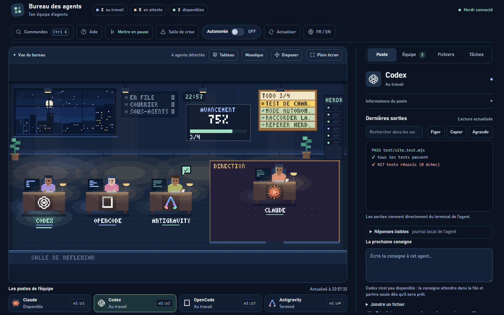
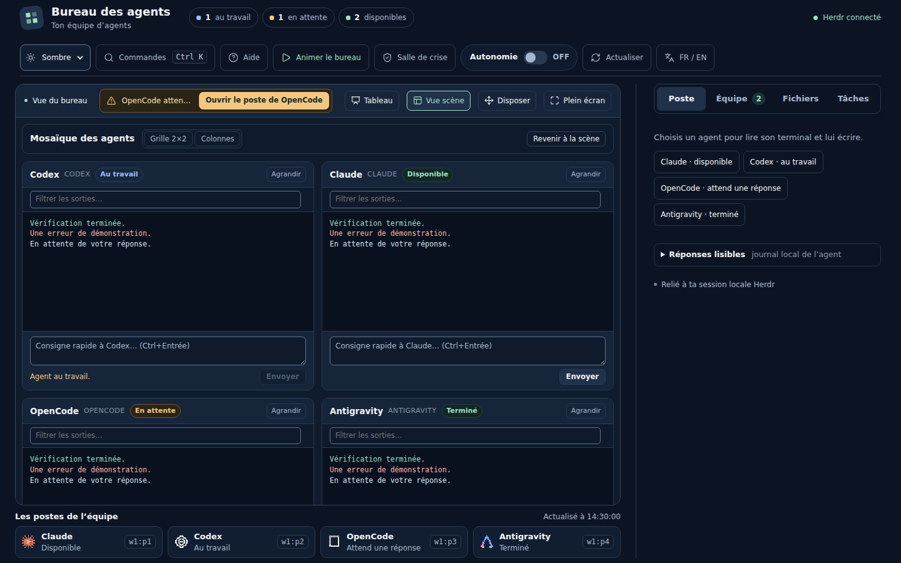
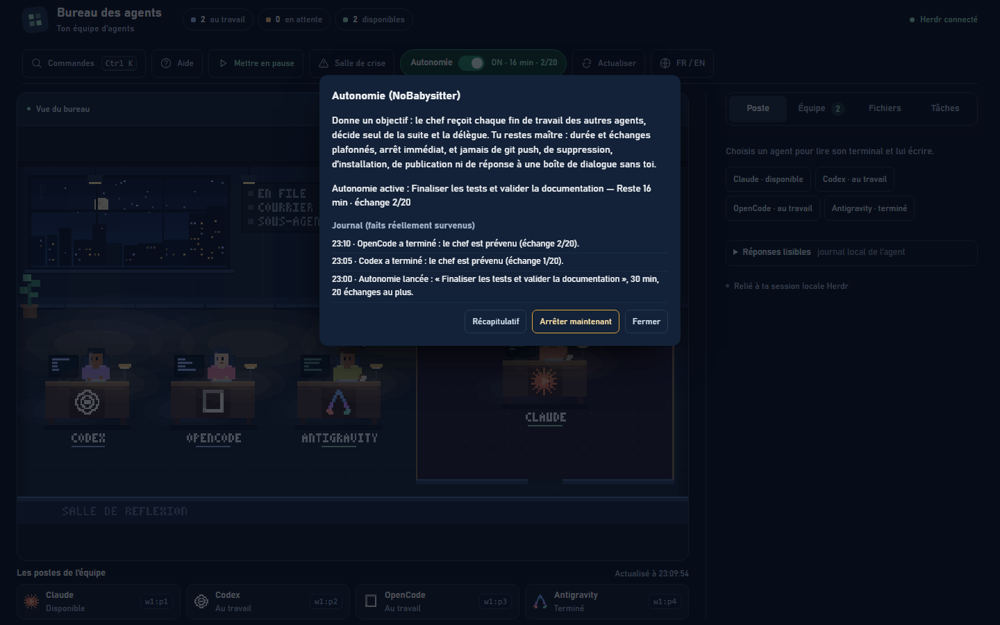
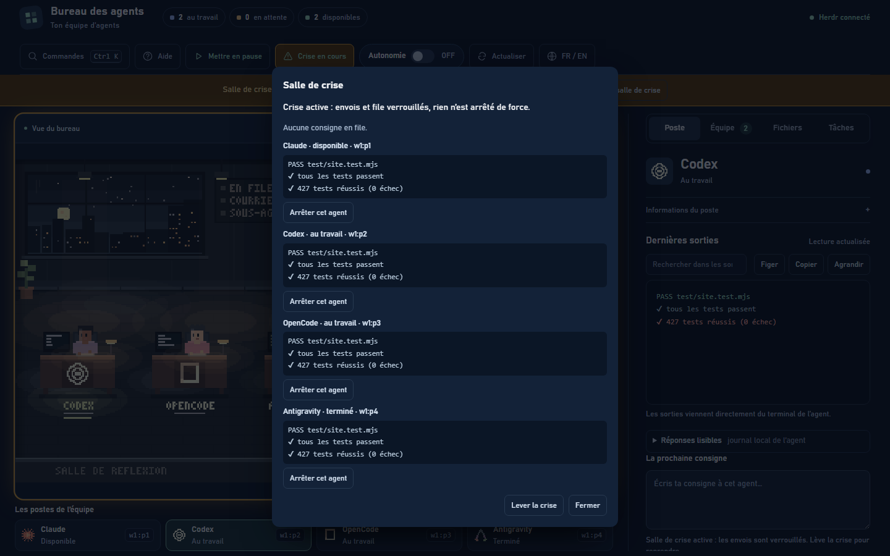

# Guide d'aide du Bureau des agents

**Français** | [English](aide.en.md)

Ce document contient l'aide intégrée du bureau pour DrSmoke et ses agents. Il peut être consulté directement ou affiché dans un panneau « ? » interactif.

---

## Choisir le projet avant de travailler (0.5.0)

Au démarrage, choisissez **Améliorer MyTeam** pour travailler sur le logiciel, ou **Créer ou reprendre un autre projet** pour votre propre dossier. Sélectionnez et validez les dossiers avant toute consigne. Le dossier et le projet actifs restent visibles ; **Changer de projet** revient à l’écran de choix `/demarrage` et arrête l’ancien contexte. Les agents doivent travailler dans les dossiers sélectionnés : un agent d’un autre projet n’est pas une cible autorisée.

La mémoire d’exécution (file, direction, autonomie et configuration) est privée, séparée par projet dans le dossier de données du système sous `MyTeam`, hors du checkout. Emplacements : Windows `%LOCALAPPDATA%/MyTeam`, macOS `~/Library/Application Support/MyTeam`, Linux `$XDG_DATA_HOME/MyTeam` ou `~/.local/share/MyTeam`. Chaque projet possède son sous-dossier `projects/<empreinte du chemin canonique>`. Une ancienne installation n’est pas importée automatiquement. Changer de projet ne rejoue pas les anciennes consignes.

Les documents techniques relus peuvent être partagés volontairement. Le kit crée ses notes `HANDOFF.md` et `JOURNAL.md` dans `.myteam-local/`, ignoré par Git, et n’écrase aucun fichier existant. `.gitignore` ne protège pas un fichier déjà suivi ou ajouté de force ; vérifiez les fichiers avant publication. Les outils d’IA conservent leurs propres journaux, droits et connexions : MyTeam ne fournit pas de bac à sable système pour ces outils.

## 1. Bienvenue sur votre bureau

Le Bureau des agents est votre tour de contrôle locale. Il vous permet de surveiller vos agents d'intelligence artificielle connectés dans Herdr et de leur transmettre vos consignes.

Tout ce qui s'affiche à l'écran provient d'observations réelles : processus Herdr actifs, sorties réelles de terminaux, journaux locaux et fichiers sur votre disque. Le bureau n'invente jamais de données, de pourcentages d'avancement ni de faux états.

L'application est bilingue (français et anglais). Un bouton « FR / EN » dans la barre d'outils supérieure permet de basculer instantanément la langue de l'ensemble de l'interface, des fiches et des messages d'erreur.

---

## 2. Fonctions clés 

### 1. La scène vivante et le bureau Direction
Le bureau Direction accueille le chef d'équipe. À chaque délégation observée dans son journal local, le chef sort de son bureau, traverse l'atelier et remet en main propre le dossier doré à son coéquipier. L'éclairage s'adapte automatiquement à l'heure locale, avec lever de soleil le matin et allumage des lampes de bureau dès 19 h 00.

### 2. Le poste de travail et les sorties en direct
Chaque collaborateur a ses sorties de terminal en direct, avec recherche instantanée et repérage des erreurs et des attentes, et un champ de consigne séparé. Les réponses Markdown sont extraites sans pollution. La file d'attente prioritaire diffère les envois vers les agents occupés ou en pause de quota : un avis de disponibilité part une minute après la levée de la pause, et la file attend 5 minutes avant de renvoyer une consigne restée en attente.

### 3. La mosaïque multi-terminaux
Le mode Mosaïque affiche les terminaux de vos coéquipiers côte à côte (4 tuiles au plus) pour surveiller le travail en direct, tandis que l'effectif global de l'équipe est testé jusqu'à 10 agents (12 en envoi groupé). Il intègre une recherche synchronisée sur toutes les tuiles, un envoi rapide de consigne (`Ctrl+Entrée`) et un rafraîchissement économique suspendu dès que l'onglet n'est plus actif.

### 4. L'autonomie supervisée (NoBabysitter)
L'interrupteur « Autonomie OFF/ON » lance un cycle de coordination en étoile où le chef décide et délègue chaque sous-tâche vers l'objectif fixé. Le mode s'arrête seul sur échéance, plafond d'échanges, boucle détectée ou salle de crise. Il rappelle au chef de ne jamais faire de `git push`, de suppression, d'installation ni de publication sans vous : c'est une consigne de prudence, pas un verrou technique, le serveur ne contrôle pas les commandes du chef. Un bouton Récapitulatif extrait le bilan Markdown complet directement depuis le journal des faits.

### 5. La salle de crise sous clapet
Accessible par raccourci clavier (`Ctrl+Maj+C`) ou depuis la barre d'outils, la salle de crise verrouille immédiatement les départs de consignes (code HTTP 423) et affiche un diagnostic en direct des sorties de chaque agent. Elle permet de transmettre un arrêt poli par la touche Échap sans tuer les processus en cours.

---

## 3. Visite guidée en 7 étapes

Cette visite rapide présente le fonctionnement essentiel de votre bureau.

### Étape 1 : Observer l'équipe dans la scène pixel art
La fenêtre principale présente votre équipe dans un décor animé en pixel art. Le ciel change en continu selon l'heure de votre ordinateur (lever à 6 h 30, coucher à 19 h 30), et l'éclairage intérieur s'allume automatiquement en soirée (suspensions et lampes de bureau). Le tableau d'affichage mural résume les faits utiles (RETOUR, EN FILE, COURRIER, SOUS-AGENTS). Le chef de l'équipe occupe le bureau Direction. Chaque personnage montre son état réel par sa posture, son écran, son emblème d'outil en façade et le soulignement coloré de son nom.

### Étape 2 : Sélectionner un poste
Cliquez sur n'importe quel personnage dans la scène (ou touchez-le sur écran tactile), sur son nom dans la liste des postes sous le bureau, ou directement dans la vue d'accueil du poste. Sur téléphone ou écran étroit, la page fait défiler l'affichage automatiquement jusqu'au panneau de pilotage.

### Étape 3 : Inspecter et guider dans l'onglet « Poste »
L'onglet « Poste » affiche les informations détaillées de l'agent : son modèle, son activité, sa consommation et les dernières lignes de son terminal. Vous pouvez figer le défilement, agrandir le terminal en pleine hauteur, rechercher du texte, consulter ses réponses structurées dans le volet « Réponses lisibles » et lui envoyer une consigne avec le raccourci Ctrl+Entrée (ou cliquer sur « Mettre en file » s'il est occupé, avec possibilité d'y joindre des fichiers locaux).

### Étape 4 : Coordonner dans l'onglet « Équipe »
L'onglet « Équipe » centralise la gestion collective. La section « Courrier du chef » vous signale chaque agent qui vient de terminer son travail. La section « Relais d'écoute du chef » permet de prévenir automatiquement le chef via la file d'attente dès qu'un collaborateur achève une tâche. La section « File d'attente » liste les consignes différées avec relance automatique. Vous pouvez aussi cocher plusieurs agents disponibles pour leur envoyer une consigne commune en deux clics sécurisés.

### Étape 5 : Gérer les documents et suivre les tâches
L'onglet « Fichiers » vous permet de voir les fichiers récemment modifiés par l'agent ou de naviguer dans les dossiers de votre projet par copie ou déplacement sans suppression. L'onglet « Tâches » affiche l'avancement des cases réellement cochées dans les fichiers du projet (`TODO.md`) et les plans d'action publiés par les agents.

### Étape 6 : Mosaïque (surveillance multi-terminaux)
Le bouton « Mosaïque » dans le cadre de la scène remplace le décor par une vue de 2 à 4 terminaux côte à côte (jusqu'à 10 agents testés, 12 en envoi groupé, mosaïque 4), avec recherche textuelle surlignée, bascule entre grille 2×2 ou colonnes, et champ de consigne rapide (Ctrl+Entrée). Le bouton « Revenir à la scène » rétablit la vue atelier à tout moment.

### Étape 7 : Salle de crise (disjoncteur d'urgence)
Le bouton sous clapet « Salle de crise » (raccourci d'urgence Ctrl+Maj+C) permet de réagir immédiatement en cas de dérive : il verrouille tous les envois directs (code HTTP 423), gèle la file d'attente et offre une modale de diagnostic calme pour ordonner une interruption polie d'un agent par la touche Échap, sans jamais recourir à un arrêt forcé (aucun kill).

---

## 4. Guide complet par zone

### Zone 1 : La scène du bureau (Vue globale)

La scène offre une vue d'ensemble immédiate sur toute votre équipe d'agents.

#### À quoi elle sert
- Surveiller d'un coup d'œil l'état de chaque agent connecté à Herdr.
- Repérer immédiatement les blocages, fins de mission et pauses de limite.
- Observer les interactions réelles entre le chef, les agents et leurs sous-agents.
- Suivre les faits utiles et les indicateurs clés au tableau d'affichage mural.

#### Le tableau d'affichage de la scène
- Placée sur le mur du fond, cette ardoise regroupe les faits utiles non répétés sur les bureaux et les cartes.
- Ligne `RETOUR` : s'affiche en violet lorsqu'un agent est en pause de quota, avec l'heure exacte de reprise annoncée par l'outil (ou `??:??` si non communiquée).
- Ligne `EN FILE` : indique le nombre de consignes en attente d'expédition dans la file d'attente sécurisée (s'allume en bleu dès qu'une consigne est en attente).
- Ligne `COURRIER` : compte les courriers non lus annonçant la fin d'une tâche (s'allume en menthe quand des courriers attendent consultation).
- Ligne `SOUS-AGENTS` : dénombre les assistants actuellement au travail dans la salle de réflexion (s'allume en gris clair si des sous-agents sont actifs).
- Chaque ligne s'allume en couleur vive dès que son fait est observé ; les lignes sans activité restent sombres et discrètes.

#### Panneau de liège et Tableau de l'équipe
- Un panneau de liège en pixel art est accroché au mur du fond (à droite du néon). Ses punaises colorées indiquent le nombre de tâches encore ouvertes dans `TODO.md` (avec un symbole `+` au-delà de 6 tâches ouvertes).
- Cliquer sur le panneau de liège ou sur le bouton « Tableau » dans le cadre de la scène ouvre la fenêtre modale du **Tableau de l'équipe**.
- Cette vue rassemble en lecture seule les 4 documents piliers du projet :
 1. **Étape en cours** : extrait synthétique de `HANDOFF.md` présentant la phase actuelle du projet.
 2. **À faire / idées** : liste des tâches et chantiers restant à accomplir extraite de `TODO.md`.
 3. **Rôles de l'équipe** : responsabilités et propriété des fichiers définies dans `AGENTS.md`.
 4. **Dernières leçons** : erreurs recensées et consignes de prudence issues de `LESSONS.md`.
- Chaque bloc indique le nom de son fichier source et la date de dernière mise à jour sur le disque.
- Sécurité et intégrité : route `/api/tableau` protégée par jeton, liste fermée de fichiers autorisés, chemins absolus et identifiants privés masqués.
- Fermeture facile : touche Échap, bouton croix ou clic sur l'arrière-plan sombre. Le focus clavier revient automatiquement au bouton ou panneau déclencheur.

#### Le bureau Direction et la tournée du chef
- Attribué au premier agent démarré dans Herdr (le chef d'équipe).
- Reconnaissable à sa moquette violette, ses boiseries élégantes et sa grande baie vitrée.
- Une pile de courriers s'accumule sur son bureau dès qu'un agent termine une tâche. Un clic sur cette pile ouvre directement l'onglet Équipe et le courrier du chef.
- Tournée du chef lors d'une délégation : à chaque mission déléguée observée dans son journal (`herdr agent prompt`), le chef se lève de son fauteuil, franchit la porte de la Direction, traverse la pièce pour aller déposer le dossier (avec le titre de la tâche en bannière dorée) directement sur le bureau du collaborateur visé, puis revient s'asseoir à sa place. Une seule tournée a lieu à la fois pour que chaque geste reste parfaitement lisible.

#### Cycle jour-nuit continu et ambiance lumineuse
- Le ciel visible par la baie vitrée évolue en temps réel selon l'heure exacte de votre machine (nuit, aube, jour, crépuscule).
- Le soleil et la lune suivent un arc horaire dans le ciel (soleil orangé près de l'horizon, lever fixe à 6 h 30 et coucher fixe à 19 h 30, approximation sans saisons).
- Les fenêtres de la ville et les étoiles s'effacent progressivement avec la montée du jour.
- Suspensions au plafond : dès 17 h 30 (pleine intensité atteinte à 19 h jusqu'au matin), les suspensions lumineuses au plafond s'allument automatiquement pour éclairer le bureau d'une douce lueur dorée.
- Lampes de bureau : chaque poste dispose d'une lampe individuelle qui s'allume le soir pour un agent présent, et reste éteinte si l'agent est parti en pause de limite.
- L'éclairage de la pièce, de la salle de réflexion et du bureau Direction s'adapte en temps réel à l'ambiance du ciel et des moniteurs.
- Réduction des mouvements : si votre système active la réduction des mouvements (`prefers-reduced-motion`), la scène est automatiquement figée par défaut (sans choix manuel enregistré). Dans cet état figé, le décor continue d'être redessiné une fois par minute pour suivre l'heure et l'éclairage.

#### Identification des postes et les 24 emblèmes d'outils Herdr
- En façade de chaque bureau, le logo 16×16 en pixel art identifie clairement l'outil parmi les 24 types supportés par Herdr : `pi`, `claude`, `codex`, `gemini`, `cursor`, `devin`, `agy`, `cline`, `omp`, `mastracode`, `opencode`, `copilot`, `kimi`, `kiro`, `droid`, `amp`, `grok`, `hermes`, `kilo`, `qodercli`, `qwen`, `letta`, `maki`, `muse`, ou l'emblème d'agent générique en cas de type inconnu.
- Ces emblèmes se retrouvent également sur les cartes d'agents et dans les tuiles de la mosaïque.
- Sous chaque bureau, le nom seul de l'agent est affiché, souligné d'un trait fin de la couleur de son état (bleu pour travail, menthe pour disponible, ambre pour attente, violet pour pause).
- Si l'application perd la liaison avec Herdr, la mention `HORS LIGNE` s'affiche sous le bureau.
- L'état n'a pas besoin d'être répété en texte : il est clairement exprimé par la posture de l'agent, le contenu de son écran, sa bulle, son emblème et le soulignement coloré de son nom.

#### Matrice de compatibilité des 24 outils Herdr
Tous les outils pris en charge par Herdr bénéficient du socle universel de surveillance et de pilotage :
- **Socle universel (tous les 24 outils)** : Détection automatique au lancement, emblème pixel art 16×16 dédié, lecture en direct des flux bruts de terminal, état unifié (travail, disponible, attente, pause de limite, hors ligne), expédition et mise en file prioritaire des consignes individuelles, et envoi groupé armé en deux clics.
- **Télémétrie enrichie (Claude Code, Codex, OpenCode)** : Pour ces 3 outils, le bureau analyse en profondeur les journaux d'activité locaux pour extraire les réponses lisibles en Markdown sans commandes brutes, la consommation exacte de jetons par tour et par session, le fil de discussion unifié, les plans d'action structurés pour l'onglet Tâches, et le suivi visuel des sous-agents dans la salle de réflexion.

#### Intégrations Herdr officielles
- La commande `herdr integration install <outil>` permet d'installer les intégrations officielles pour les outils compatibles : `pi`, `omp`, `claude`, `codex`, `copilot`, `devin`, `droid`, `kimi`, `opencode`, `kilo`, `hermes`, `qodercli`, `qwen`, `letta`, `cursor`, `mastracode`, `antigravity-cli`, `grok`.
- Ces intégrations modifient la configuration de l'outil pour faire remonter à Herdr et au bureau les états précis, les contextes de session et l'activité réelle de l'agent.

#### Postures des personnages
- Frappe au clavier : agent au travail sur une tâche (bleu ciel).
- Mug en main : agent disponible, en attente de sa prochaine consigne (menthe).
- Bras levé : agent en attente d'une validation ou d'une réponse de votre part (ambre).
- Sourire et étincelles : le travail vient de s'arrêter (passage réel de « au travail » à « terminé ») ; le résultat reste à vérifier dans ses sorties.
- Fauteuil vide : agent en pause de quota (limite d'utilisation atteinte).

#### Bulles au-dessus des postes
- Point d'interrogation ambre : l'agent demande une confirmation ou une saisie dans Herdr.
- Coche verte : travail terminé selon Herdr, résultat à vérifier dans les sorties réelles.
- Points de suspension gris : statut transitoire ou non renseigné par l'outil.

#### Couleurs d'état
- Bleu ciel : au travail (exécution de commandes, écriture de code).
- Menthe : disponible ou travail terminé.
- Ambre : attente d'une intervention de votre part.
- Violet doux : en pause de quota.
- Gris ardoise : état inconnu ou agent déconnecté.

#### Pause de quota et chevalet « RETOUR »
- Quand un outil atteint son plafond de requêtes ou de jetons, l'agent quitte son fauteuil.
- L'écran de son ordinateur s'éteint, sa lampe de bureau s'éteint et une veilleuse violette clignote discrètement.
- Un chevalet blanc portant la mention « RETOUR » affiche l'heure exacte de reprise annoncée par l'outil.
- Le serveur local planifie la relance automatique des consignes en attente 5 minutes après cette heure.
- Reprise automatique : une minute après la fin de la pause (heure de retour annoncée), le serveur envoie automatiquement dans la file d'attente une consigne courte à l'agent lui rappelant de répondre « dispo » et de reprendre sa mission en cours (`git status`, puis la consigne du chef) sans rien refaire de déjà commité, afin d'économiser son quota. Une seule fois par pause, en mémoire vive uniquement (un redémarrage du serveur ne rattrape aucune consigne).

#### Salle de réflexion repliable des sous-agents
- Pièce vitrée dédiée portant le libellé fixe « SALLE DE REFLEXION » (ou « REFLEXION » sur écran étroit), jamais tronqué quelle que soit l'activité.
- Lorsqu'un agent délègue une partie de son travail à des sous-agents, de petits assistants quittent son poste en portant un dossier doré.
- Ils traversent le couloir et entrent dans la salle de réflexion vitrée.
- Ils s'installent à table sur leurs ordinateurs portables ou travaillent au tableau blanc.
- Le nombre exact de sous-agents en réflexion est indiqué en direct sur le tableau mural de la scène.
- Dès que leurs analyses sont terminées, ils reviennent déposer le dossier complété sur le bureau de leur agent avant de quitter la pièce.
- La salle de réflexion dispose d'une option de repli pour adapter l'affichage de la scène aux écrans compacts.

#### Mode « Disposer » (Personnalisation de la scène)
- Cliquez sur le bouton « Disposer » en haut à droite du cadre de la scène.
- Une barre d'aide dédiée s'affiche sous les outils pour rappeler les commandes.
- Glissez chaque bureau d'agent à l'endroit désiré sur le sol (ou déplacez-le aux flèches du clavier).
- Déplacez le bureau Direction du chef ou redimensionnez-le en étirant son coin doré en bas à droite.
- Cliquez sur « Réinitialiser » pour rétablir la disposition automatique.
- Appuyez sur la touche Échap ou cliquez sur « Terminer » pour valider et enregistrer vos réglages.

#### Mode Mosaïque (Surveillance multi-terminaux)
- Le bouton « Mosaïque » dans le cadre de la scène (ou la commande « Mode mosaïque » de la palette Ctrl+K) remplace le décor en pixel art par une mosaïque modulaire de 2 à 4 terminaux côte à côte (jusqu'à 10 agents testés, 12 en envoi groupé, mosaïque 4).
- Les collaborateurs au travail apparaissent automatiquement en tête de liste pour suivre leurs progrès sans délai.
- Si l'équipe compte plus de 4 agents, une barre de sélection propose des cases à cocher pour choisir les agents à afficher (4 tuiles au maximum).
- Bascule de disposition : boutons « Grille 2×2 » et « Colonnes » (sur smartphone, les tuiles se disposent en colonne unique adaptée à l'écran).
- Chaque tuile propose :
  - Un en-tête compact avec nom, emblème de l'outil, badge de statut et bouton « Agrandir » pour ouvrir le poste individuel complet.
  - Le texte brut du terminal dans un bloc défilant propre, nettoyé des séquences d'échappement ANSI.
  - Un champ de recherche textuelle avec surlignage des occurrences et compteur de correspondances.
  - Un formulaire de consigne rapide expédiable avec `Ctrl+Entrée`, automatiquement désactivé avec mention explicite quand l'agent n'est pas disponible.
- Rafraîchissement économique : les tuiles visibles sont interrogées toutes les 3 secondes, le rafraîchissement se suspend si l'onglet du navigateur est masqué, une seule lecture à la fois par tuile pour éviter toute congestion, et la sélection de texte dans un terminal n'est jamais interrompue.
- Le bouton « Revenir à la scène » ou la commande de palette rétablit instantanément la scène animée.

---

### Zone 2 : Onglet « Poste » (Pilotage individuel)

Cet onglet permet d'inspecter l'agent sélectionné et d'échanger directement avec lui.

#### À quoi il sert
- Consulter l'activité détaillée, le modèle et la consommation de l'agent.
- Lire le texte réel affiché dans son terminal Herdr.
- Rechercher des erreurs, figer le défilement et copier des extraits de code.
- Rédiger et envoyer une nouvelle consigne individuelle.

#### Barre d'état de l'outil
- Titre de la tâche en cours ou pensée extraite en direct de l'outil.
- Modèle utilisé (tel que l'outil l'affiche, par exemple GPT-6.1-Sol pour Codex ou MiMo V2.6 Pro pour OpenCode), mode et niveau d'effort.
- Jauge visuelle de la limite restante avec heure de remise à zéro.
- Temps d'exécution écoulé et nombre d'avertissements détectés.

#### Outils du terminal
- Champ « Rechercher dans les sorties » : met en surbrillance instantanée les termes cherchés et affiche le nombre de correspondances.
- Bouton « Figer » : interrompt le défilement automatique vers le bas pour vous laisser lire calmement une trace d'erreur ou du code. Cliquez sur « Reprendre » pour réactiver le suivi.
- Bouton « Copier » : copie l'intégralité du texte du terminal affiché dans votre presse-papier.
- Bouton « Agrandir » : étend la hauteur du terminal pour occuper tout l'espace disponible et lire de longs historiques en pleine page, y compris sur téléphone où il déploie une hauteur dédiée confortable.
- Pause automatique sur sélection : dès que vous sélectionnez du texte à la souris dans les sorties, l'actualisation se met en pause avec la mention « Sélection en cours, affichage en pause ». Votre sélection ne saute jamais.

#### Volet « Réponses lisibles »
- Sous les sorties brutes du terminal, un volet dépliable permet de lire les réponses structurées de l'agent lues dans son journal local (Claude, Codex, OpenCode).
- Rendu Markdown sûr et propre sans `innerHTML` (titres, listes, citations, gras, code en ligne et blocs de code).
- Bouton « Copier le code » pour chaque bloc de code et bouton « Copier la réponse » pour récupérer le Markdown source exact.
- Boutons d'exportation locale en fichier `.md` (réponse unitaire ou session complète). Une réponse en cours est exportée comme instantané daté portant la mention « partiel ».
- Repli accessible : si l'accès au presse-papiers est refusé ou indisponible, une boîte modale avec zone de texte en lecture seule s'ouvre pour vous permettre de copier le texte manuellement.

#### Envoi de consigne, mise en file et priorité
- Agent disponible : la zone de texte est déverrouillée et permet un envoi immédiat avec le raccourci clavier Ctrl+Entrée (ou Cmd+Entrée).
- Agent occupé ou en pause de quota : le bouton affiche « Mettre en file ». La consigne est enregistrée dans la file d'attente sécurisée du serveur et partira toute seule dès que l'agent sera disponible ou 5 minutes après sa remise à zéro de limite.
- Case « Prioritaire » : en cochant cette case avant de cliquer sur « Mettre en file », la consigne reçoit une priorité haute (`priority: "haute"` au lieu de `"normale"`) pour être traitée en tête de file dès que l'agent redevient disponible.
- Joindre des fichiers : vous pouvez associer jusqu'à 2 fichiers locaux (20 Mo max) à une consigne mise en file d'attente. Les fichiers sont copiés de manière sécurisée sans écrasement dans le dossier de travail de l'agent avant le départ de la consigne.
- Conservation des brouillons : si vous changez d'agent alors qu'un texte est commencé ou pendant l'envoi d'une consigne en file, chaque brouillon reste mémorisé indépendamment sans être écrasé par l'autre poste.

---

### Zone 3 : Onglet « Équipe » (Coordination collective)

Cet onglet gère les échanges avec plusieurs agents, la file d'attente, la direction de l'équipe et la réception des rapports de fin de travail.

#### À quoi il sert
- Prendre connaissance des missions terminées grâce au courrier du chef.
- Suivre et administrer les consignes en attente dans la file d'attente avec gestion des priorités.
- Désigner le chef d'équipe et gérer les propositions de passation en cas de pause de quota.
- Configurer le relais d'écoute pour prévenir automatiquement le chef dès qu'un agent termine.
- Transmettre une même directive à plusieurs agents en une seule action.
- Consulter le journal des transmissions de la session.

#### Direction de l'équipe et passation
- Chef effectif : le bureau Direction est occupé par le chef de l'équipe. Par défaut, c'est le premier agent démarré dans Herdr (règle du plus petit panneau).
- Choix explicite de la personne qui utilise le bureau : une section « Direction de l'équipe » dans l'onglet Équipe permet de désigner n'importe quel autre agent connecté comme chef ou de rétablir la règle par défaut. Ce choix est conservé sur le disque (`direction.json` (état privé du projet)). Si l'agent choisi disparaît de Herdr, le serveur revient à la règle par défaut sans altérer le fichier.
- Bandeau de proposition de passation : si le chef effectif atteint son plafond d'utilisation et entre en pause de limite, un bandeau apparaît en haut de l'onglet Équipe pour proposer proactivement de passer la direction à un suppléant disponible.
- Confirmation et message de passation relu : la passation n'est jamais automatique. DrSmoke valide le changement, et le message de passation préparé est relu et validé avant d'être expédié à l'équipe (par envoi direct ou via la file d'attente).
- Suivi des délégations : les missions déléguées (`herdr agent prompt`) et la tournée du chef sont suivies dans le journal du chef effectif (qu'il soit issu du choix ou de la règle).

#### Courrier du chef
- Chaque fois qu'un agent passe de l'état « au travail » à « disponible » ou « terminé », un courrier est enregistré avec compteur dans le titre de section.
- La liste se remet automatiquement à zéro dès que vous consultez l'onglet Équipe.
- Un clic sur un courrier ou sur son bouton « Ouvrir son poste » permet d'accéder directement au terminal de l'agent pour vérifier son travail.
- Rappel de prudence : le courrier confirme l'arrêt du processus de travail, pas la réussite de l'objectif. Vérifiez toujours les sorties réelles.

#### Relais d'écoute du chef
- Section dédiée dans l'onglet Équipe : case à cocher « Prévenir le chef quand un agent termine ».
- Option facultative, désactivée par défaut, conservée sur le disque dans `relais.json` (état privé du projet).
- Fonctionnement : dès qu'un agent passe de l'état « au travail » à « disponible » ou « terminé », le serveur génère et insère dans la file d'attente une consigne de priorité normale pour le chef effectif : *« [Nom] vient de terminer. Lis son panneau avant de lui confier la suite. »*
- Sécurité et anti-saturation : une seule notification par fin observée, au minimum une minute d'espacement entre deux avis pour le même agent, persistance de l'état avant la file pour éviter toute répétition automatique en cas de réponse réseau perdue.
- Jamais en crise : si la salle de crise est enclenchée, le relais d'écoute est totalement neutralisé ; aucun message n'est généré ni envoyé au chef pendant toute la durée de la crise.

#### File d'attente des consignes et priorités
- Affiche la liste des consignes en attente d'expédition avec le destinataire, l'horodatage, le statut et le niveau de priorité (« haute » ou « normale »), ordonnée selon l'ordre réel d'envoi prévu.
- Bouton « Passer en tête » : permet de promouvoir d'un clic une consigne normale en attente au rang de priorité haute.
- Ordre de départ par agent : les consignes de priorité haute partent en premier (selon leur date d'arrivée), suivies des consignes normales.
- Garde-fou d'attente (anti-famine) : une consigne normale en attente depuis plus de 30 minutes est automatiquement promue au rang des hautes pour ne jamais être bloquée indéfiniment.
- Respect absolu des états : la priorité haute ne force jamais d'envoi vers un agent occupé ou en pause de limite. Le serveur attend la disponibilité effective de l'agent (ou 5 minutes après sa remise à zéro).
- Chaque consigne peut être annulée d'un clic grâce à son bouton de retrait unitaire.
- Protection anti-double envoi : persistance atomique sur disque, clé d'idempotence et gel d'envoi en cas de doute.

#### Message à plusieurs agents (Envoi groupé en deux clics)
- Cochez les agents à qui vous souhaitez vous adresser (seuls les agents disponibles peuvent être sélectionnés, jusqu'à 10 agents testés, 12 en envoi groupé, mosaïque 4).
- Le bouton « Cocher tous les disponibles » permet de sélectionner l'ensemble des agents libres en un seul clic.
- Saisissez votre consigne commune dans la zone de texte.
- Premier clic sur « Envoyer » (ou Ctrl+Entrée) : arme l'envoi et affiche clairement les noms de tous les destinataires.
- Second clic : confirme l'envoi. La même consigne part alors séparément à chaque agent choisi via Herdr.

#### Journal des envois de la session
- Consigne chaque envoi réalisé depuis l'ouverture du bureau.
- Affiche l'heure, les destinataires, le texte et le statut de transmission retourné par Herdr.

#### Fichiers confiés et suivi de traitement
- Affiche la liste des dossiers de traitement pour les fichiers confiés aux agents par consigne.
- Retrace chronologiquement chaque fait observé avec sa source exacte (`file`, `disque`, `herdr`, `journal`) : date de mise en file, copie effectuée, changements du fichier sur le disque pendant le travail de l'agent, et détection de fin de réponse.
- Règle de vérité : aucun verdict « réussi » ou « terminé » n'est affirmé ; seuls les faits datés et observés sont affichés.

#### Fil de discussion (Salle de contrôle)
- Centralise les extraits des réponses récentes de l'ensemble des agents de l'équipe, ordonnées de la plus récente à la plus ancienne.
- Chaque bulle présente le nom de l'agent, l'heure de publication, son état observé et un extrait textuel de sa réponse.
- Sous le fil, une section recense les agents non lus avec la raison observée (« non exposé par cet outil » ou « non rattaché avec certitude »).

---

### Zone 4 : Onglet « Fichiers » (Explorateur sécurisé)

Cet onglet permet de consulter et d'organiser les fichiers du projet en lien avec vos agents.

#### À quoi il sert
- Découvrir rapidement les fichiers récemment créés ou modifiés par un agent.
- Parcourir l'arborescence des dossiers du projet.
- Ouvrir un emplacement dans l'Explorateur Windows en un clic.
- Copier ou déplacer des fichiers entre différents dossiers de travail.

#### Sécurité et intégrité absolue
- Aucune fonction de suppression n'existe dans le bureau.
- Aucun fichier ne peut être écrasé : si un fichier du même nom existe dans la destination, il est automatiquement renommé avec un indice numérique.
- La navigation est limitée aux lieux autorisés : le dossier de travail de chaque agent, Bureau, Documents et Téléchargements. Aucun chemin venant du navigateur n'est accepté.

#### Vue Récents et vue Parcourir
- Bouton « Récents » : liste les fichiers modifiés au cours des 48 dernières heures dans le dossier de travail de l'agent sélectionné.
- Bouton « Parcourir » : exploration dossier par dossier avec barre de navigation (fil d'Ariane) cliquable.

#### Actions sur les fichiers
- Bouton « Afficher » : révèle directement le fichier sélectionné dans l'Explorateur Windows de votre poste.
- Glisser-déposer standard : glissez un fichier vers l'un des lieux de la liste « Déposer dans » pour en créer une copie.
- Maj + Glisser-déposer : maintenez la touche Maj enfoncée pendant le glisser-déposer pour déplacer le fichier. Un message d'avertissement vous demandera un second geste identique pour confirmer le déplacement.

---

### Zone 5 : Onglet « Tâches » (Suivi factuel des plans)

Cet onglet permet de suivre l'avancement concret du travail sans estimation artificielle.

#### À quoi il sert
- Afficher les cases à cocher réelles trouvées dans les fichiers de documentation du projet (`TODO.md`).
- Consulter les plans d'action structurés publiés par les agents dans leurs journaux d'activité.
- Observer une barre de progression strictement calculée sur le nombre de tâches cochées par rapport au total.

#### Règle de vérité des tâches et pourcentage
- La barre de progression et le pourcentage affiché sont strictement calculés sur le ratio de cases cochées réelles par rapport au total.
- Aucun pourcentage n'est extrapolé ni prédit.
- Si un agent ne publie pas de plan dans ses sorties ou journaux, le bureau affiche « Aucun plan publié par un agent pour le moment ».

---

### Zone 6 : Palette de commandes, interface bilingue et signaux

#### Palette de commandes (Ctrl+K)
- Accessible par le bouton « Commandes » ou le raccourci clavier Ctrl+K.
- Permet de chercher un agent, ouvrir son poste, rédiger un message, ouvrir le tableau de l'équipe (« Mémoire partagée »), basculer d'onglet ou lancer une action sans lâcher le clavier.
- Navigation fluide : flèches haut et bas pour choisir, Entrée pour valider, Échap pour fermer.

#### Santé du bureau
- Dans l'aide (touche `?`), une ligne indique si Herdr répond, combien de journaux d'agents sont trouvés et si le serveur exécute bien la dernière version des fichiers.
- La pastille « Redémarrage à prévoir » apparaît dans l'en-tête quand le serveur exécute un code plus ancien que les fichiers : relance-le quand aucun mode Autonomie ne tourne (un redémarrage clôt ce mode).
- Le bouton « Copier le diagnostic » copie les versions et les états seulement : jamais de chemin, de clé, d'objectif ni de message. Utile pour demander de l'aide sans exposer son terminal.

#### Interface bilingue FR / EN
- Bouton « FR / EN » situé dans la barre d'en-tête (à côté du bouton Aide).
- Détection automatique : au premier chargement, la langue s'aligne sur celle de votre navigateur (`navigator.language`).
- Bascule manuelle : un clic sur le bouton permute la langue et enregistre votre choix dans le navigateur (`bureau.langue`).
- Couverture complète : l'ensemble des boutons, fiches d'état, formulaires, aides et messages d'erreur du serveur sont instantanément traduits.

#### Panneau d'aide latéral (Touche ?)
- Accessible par le bouton « Aide » ou la touche « ? », ouvert automatiquement à la première visite.
- Contient la visite guidée en 7 étapes, les légendes visuelles et les boutons de contrôle des signaux.

#### Mode Autonomie supervisée (NoBabysitter)
- Accessible par le bouton « Autonomie » dans la barre d'outils supérieure (titre : « Autonomie supervisée : le chef décide de la suite avec un plafond »).
- Modale « Autonomie (NoBabysitter) » : permet de lancer une séquence de travail autonome supervisée en renseignant un objectif clair (5 à 300 caractères), une durée maximale (5 à 120 minutes, 30 min par défaut) et un plafond d'échanges (3 à 60, 20 par défaut).
- Architecture en étoile : le chef d'équipe centralise tout. À chaque fin de travail d'un collaborateur, le relais d'écoute ajoute dans la file d'attente du chef une consigne lui rappelant l'objectif, le compte d'échanges (`{n}/{max}`) et l'heure limite. Le chef décide seul de la suite et la délègue. Aucun agent n'écrit directement à un autre sans passer par le chef.
- Garde-fous et sécurité absolue :
  - Jamais de push Git, de suppression de fichier, d'installation de paquet, de publication ni de validation de boîte de dialogue sans l'accord explicite de DrSmoke.
  - Pas d'autonomie totale promise : l'autonomie reste strictement supervisée, bornée et mesurable.
- Arrêts automatiques et sécurisés :
  - Échéance temporelle (`durée écoulée`).
  - Plafond d'échanges atteint (`plafond d'échanges atteint`).
  - Détection de boucle (`boucle détectée`, quand un même agent termine trop souvent dans une fenêtre de 10 minutes).
  - Enclenchement de la crise (`salle de crise enclenchée`).
  - Redémarrage du serveur (`redémarrage du serveur` : jamais de reprise silencieuse sans consentement).
  - Arrêt manuel immédiat : bouton « Arrêter maintenant » disponible à tout moment.
- Journal factuel : la modale affiche en temps réel les faits survenus (lancement, messages transmis au chef, motifs d'arrêt).
- Suivi en direct : lorsque le mode est actif, le bouton affiche en temps réel le temps restant et le ratio d'échanges (`Autonomie · {reste} · {n}/{max}`).

---

### Zone 7 : Disjoncteur général « Salle de crise »

La salle de crise est un mécanisme de sûreté conçu pour reprendre la main en cas d'emballement d'un agent, de boucle de messages incontrôlée ou de défaillance critique, sans jamais détruire les travaux en cours.

#### Enclenchement et signal visuel
- Accessible à tout moment via le bouton de sécurité sous clapet « Salle de crise » dans la barre d'en-tête, le raccourci d'urgence `Ctrl+Maj+C` ou la palette de commandes Ctrl+K.
- Dès l'enclenchement, la scène s'habille d'un halo ambré de sécurité et un bandeau d'alerte apparaît en haut de page.
- Le bouton principal de la modale demande une confirmation explicite avant d'armer la crise (« Confirmer : enclencher la crise »).

#### Effets immédiats du verrou de crise
- **Verrouillage absolu des envois directs** : les routes `/api/prompt` et `/api/broadcast` répondent par le code HTTP 423 avec un message explicite (« Salle de crise active : les envois sont verrouillés »).
- **Gel de la file d'attente** : les consignes continuent d'être reçues et enregistrées en file sans perte, mais aucun départ automatique n'a lieu tant que la crise reste active.
- **Suspension de la passation et du relais d'écoute** : le message de passation de direction et le relais d'écoute du chef sont totalement suspendus pendant toute la durée de la crise.
- **Persistance atomique** : l'état `{active, since, reason}` est conservé dans `crise.json` (état privé du projet) hors Git. Si le fichier est corrompu ou illisible, la crise reste active par défaut par précaution.

#### Diagnostic calme et interruption polie
- La modale liste chaque collaborateur connecté avec son état observé, son panneau Herdr et les 4 dernières lignes réelles de son terminal.
- **Interruption polie par agent** : DrSmoke peut cliquer sur « Arrêter cet agent » puis confirmer (« Confirmer : interrompre [Nom] »). Le serveur transmet alors la touche Échap canonique (`esc` dans Herdr via `POST /api/crise/arret`).
- **Règle absolue** : aucun processus n'est brutalement tué (`kill`). L'agent est invité à s'arrêter proprement au niveau applicatif pour préserver l'intégrité de ses fichiers sur le disque.
- **Reprise** : une fois la situation assainie, DrSmoke clique sur « Lever la crise » pour déverrouiller instantanément les envois et relancer la file.

---

## 5. Kit d'équipe et outillage (docs/kit.md)

Le kit d'équipe apporte à n'importe quel projet la méthode et les outils de collaboration multi-agents utilisés pour bâtir MyTeam. Consultez [docs/kit.md](kit.md) pour la documentation exhaustive.

### Fichiers piliers
- `AGENTS.md` : Règles de collaboration pour toutes les IA (rôles, propriété des fichiers, vérité des faits, définition de « terminé », sécurité).
- `CHEF.md` : Guide du chef d'équipe pour écouter, déléguer, évaluer, corriger et fusionner.
- `LESSONS.md` : Mémoire partagée des erreurs à ne jamais reproduire.
- `TODO.md` et `HANDOFF.md` : Tâches ouvertes et état d'avancement pour passer le relais sans perte d'information.

### Scripts du kit
- **Initialisation** : `node scripts/init-kit.mjs <dossier> [--lang fr|en]` déploie les fichiers piliers sans jamais écraser de documents existants.
- **Auto-évaluation factuelle** : `node scripts/evaluer.mjs [dossier]` génère un rapport basé uniquement sur des faits vérifiés (piliers présents, ratio de cases cochées, leçons, statut Git et exécution des tests `npm test` et `npm run check`). Code de sortie 1 en cas de manquement ou d'échec.
- **Partage des leçons** : `node scripts/partager-lecons.mjs "La leçon en une ligne." [dossier]` ajoute la leçon à `LESSONS.md` et notifie avec bienveillance les agents Herdr actuellement disponibles (`idle` ou `done`), sans jamais interrompre un collaborateur au travail.

---

## 6. Tableau des raccourcis et commandes rapides

| Zone | Action ou raccourci | Effet |
| :--- | :--- | :--- |
| **Général** | `Ctrl + K` | Ouvre la palette de commandes modale. |
| **Général** | Bouton `FR / EN` | Bascule instantanément la langue de l'interface entre français et anglais. |
| **Général** | Bouton « Autonomie » | Ouvre la fenêtre de configuration du mode autonomie supervisée (NoBabysitter). |
| **Général** | Palette Ctrl+K : « Tableau de l'équipe » | Ouvre la fenêtre modale du tableau de l'équipe (mémoire partagée). |
| **Général** | Palette Ctrl+K : « Mode mosaïque » | Bascule entre la vue scène pixel art et la mosaïque de terminaux. |
| **Général** | Palette Ctrl+K : « Salle de crise » | Ouvre la modale de diagnostic et de gestion de la salle de crise. |
| **Général** | `Ctrl + Maj + C` | Ouvre immédiatement la modale de la salle de crise (disjoncteur d'urgence). |
| **Général** | Touche `?` | Ouvre ou ferme ce volet d'aide. |
| **Scène** | Clic sur le panneau de liège ou bouton « Tableau » | Ouvre le tableau de l'équipe en lecture seule (fichiers piliers). |
| **Scène** | Bouton « Mosaïque » / « Vue scène » | Bascule l'affichage entre la scène animée et la grille de 2 à 4 terminaux. |
| **Scène** | Clic sur un personnage (ou toucher sur écran tactile) | Ouvre son poste individuel (fait défiler sur mobile). |
| **Scène** | Clic sur la pile de courrier | Ouvre l'onglet Équipe et la section Courrier du chef. |
| **Scène** | Bouton « Disposer » | Active la réorganisation manuelle des bureaux. |
| **Scène** | Touche `Échap` | Ferme une seule couche à la fois : la salle de crise, puis la palette, puis le tableau de l'équipe, puis « Disposer », puis l'aide. |
| **Scène** | Bouton « Plein écran » | Agrandit la scène et le panneau dans une vue unifiée. |
| **Scène** | Bouton « Mettre en pause » | Coupe ou réactive les animations du canvas (figée, la scène suit l'heure chaque minute). |
| **Navigation**| `Flèche droite` / `Flèche gauche` | Passe d'un onglet à l'autre (Poste, Équipe, Fichiers, Tâches). |
| **Poste** | `Ctrl + Entrée` (ou `Cmd + Entrée`) | Envoie la consigne à l'agent sélectionné. |
| **Poste** | Case à cocher « Prioritaire » | Marque la consigne pour un traitement prioritaire en file. |
| **Poste** | Bouton « Mettre en file » | Place la consigne dans la file d'attente si l'agent est occupé. |
| **Poste** | Bouton « Agrandir » | Agrandit ou réduit le terminal en pleine hauteur (y compris sur mobile). |
| **Poste** | Volet « Réponses lisibles » | Déplie les réponses structurées de l'agent avec copie de code et export Markdown. |
| **Poste** | Sélection de texte dans le terminal | Suspend temporairement l'actualisation pour copier. |
| **Poste** | Bouton « Figer » | Bloque le suivi automatique vers le bas. |
| **Poste** | Bouton « Copier » | Place le texte complet du terminal dans le presse-papier. |
| **Mosaïque**| Bouton « Grille 2×2 » / « Colonnes » | Change la disposition des tuiles dans la mosaïque. |
| **Mosaïque**| `Ctrl + Entrée` dans une tuile | Expédie la consigne rapide vers l'agent affiché dans cette tuile. |
| **Mosaïque**| Bouton « Agrandir » d'une tuile | Ouvre le poste unitaire complet de l'agent concerné. |
| **Mosaïque**| Bouton « Revenir à la scène » | Ferme la mosaïque et réaffiche la scène animée du bureau. |
| **Crise** | Bouton « Salle de crise » | Ouvre le panneau de diagnostic et d'urgence de la salle de crise. |
| **Crise** | Bouton « Arrêter cet agent » | Demande l'interruption polie (Échap) d'un agent après confirmation. |
| **Crise** | Bouton « Lever la crise » | Déverrouille les envois directs et relance le traitement de la file. |
| **Équipe** | Section « Direction de l'équipe » | Choisit le chef d'équipe, rétablit la règle ou valide une passation. |
| **Équipe** | Case « Relais d'écoute du chef » | Active ou désactive l'envoi d'une consigne neutre au chef à chaque fin observée. |
| **Équipe** | Bouton « Passer en tête » | Promeut une consigne en attente au rang de priorité haute. |
| **Équipe** | Bouton « Retirer » | Supprime une consigne en attente dans la file. |
| **Équipe** | `Ctrl + Entrée` (ou `Cmd + Entrée`) | Déclenche l'envoi groupé armé. |
| **Équipe** | Bouton « Cocher tous les disponibles » | Sélectionne tous les agents prêts en un seul clic. |
| **Fichiers** | Glisser-déposer sur un lieu | Copie le fichier vers le dossier choisi. |
| **Fichiers** | `Maj` + Glisser-déposer sur un lieu | Déplace le fichier (nécessite une confirmation). |
| **Fichiers** | Bouton « Afficher » | Ouvre le dossier du fichier dans l'Explorateur Windows. |

---

## 7. Règle d'or : La vérité des faits

Le Bureau des agents applique une règle d'intégrité stricte :
1. Seuls les faits observables sont affichés (processus réels, horloge de l'ordinateur, journaux locaux, fichiers du disque).
2. Aucun pourcentage d'avancement inventé n'est proposé lorsqu'un outil ne le calcule pas lui-même.
3. Si un outil ne publie pas sa consommation de jetons ou ses sous-agents, la mention « Non exposé par cet outil » est fidèlement indiquée.
4. Une erreur constatée n'est jamais masquée : elle est rapportée dans les sorties et vient enrichir le document LESSONS.md pour prémunir l'équipe contre toute récidive.

## Apparence et icônes

Dans la barre supérieure, choisis Système, Clair ou Sombre. Système suit l'apparence de ton ordinateur ; un choix explicite reste prioritaire. Le choix est mémorisé dans ce navigateur. Le site public et le bureau local conservent chacun leur préférence. Le ciel du bureau suit toujours l'heure réelle ; le terminal garde un fond sombre pour ses couleurs. Les contrôles utilisent des icônes Lucide livrées localement.
